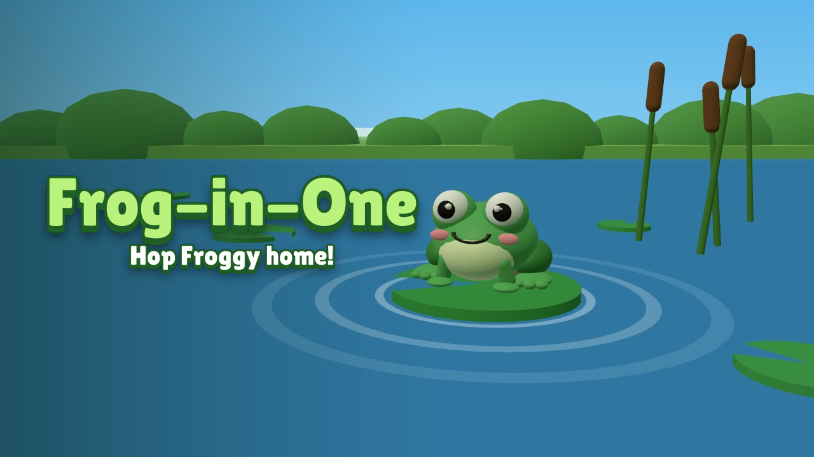
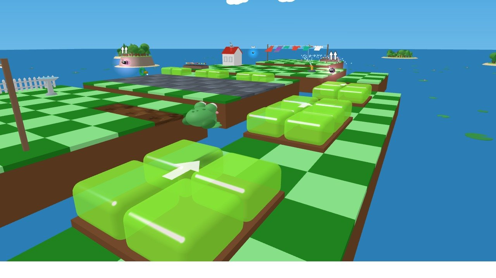
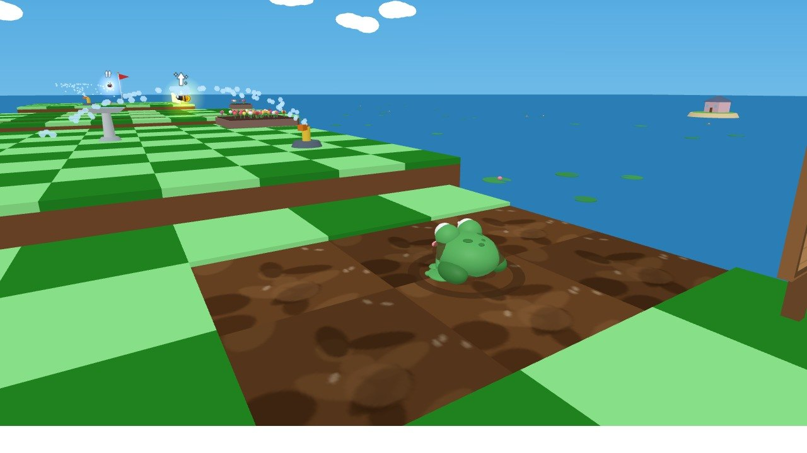
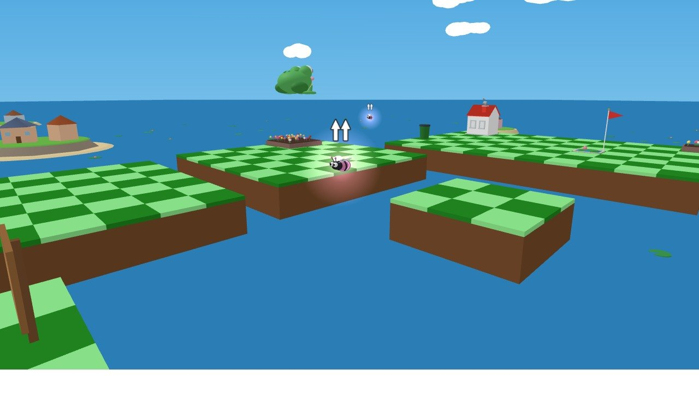
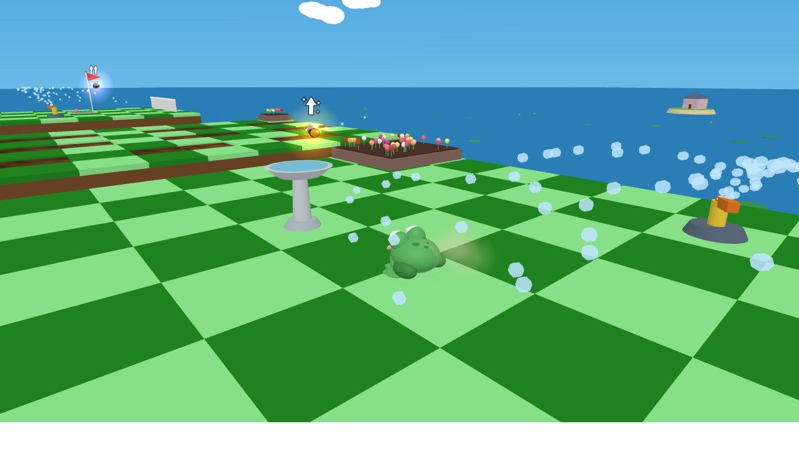
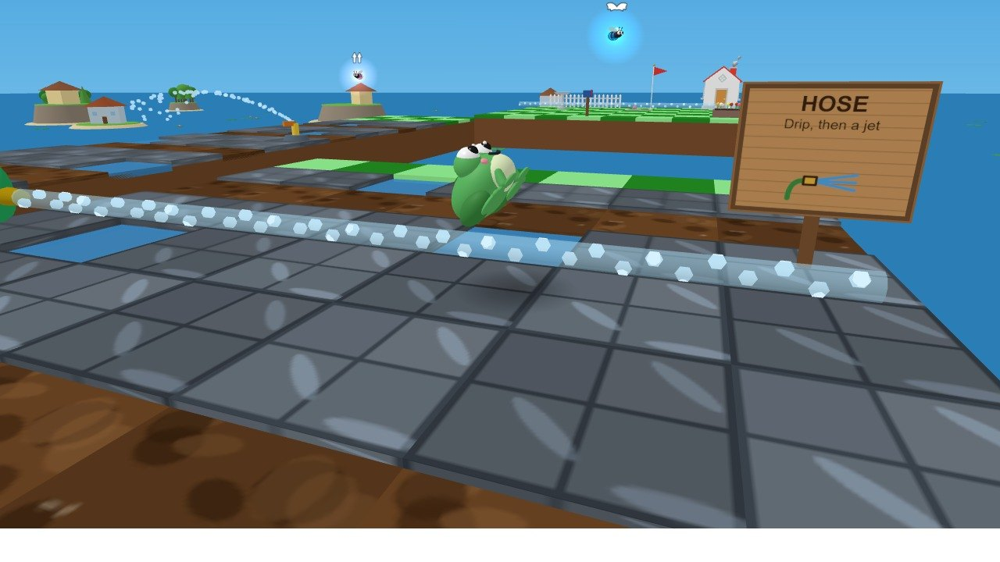
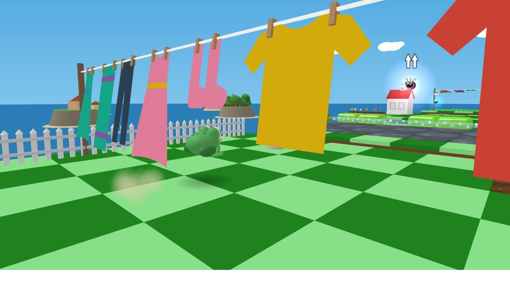
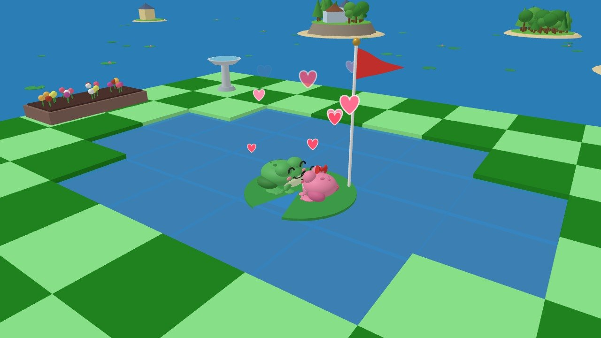

<h1 align="center">Frog-in-One</h1>

<p align="center"><b>Hop Froggy home, one hop at a time.</b><br>
A cosy 3D mini-golf platformer you play right in your browser.</p>

<p align="center">
  <a href="https://frog-in-one.netlify.app"><b>▶ Play now</b></a> &nbsp;·&nbsp;
  <a href="trailer/frog-in-one-trailer.mp4"><b>Watch the trailer</b></a>
</p>

<p align="center">
  <a href="https://frog-in-one.netlify.app"></a>
</p>

Froggy is a long way from home, and his wife is waiting by the garden pond with dinner. Drag back from him, let go, and hop him across floating lawns and through five neighbourhood levels, landing on the lily pad by the red flag in as few hops as you can. Beat par and the clock for three stars, then see how you rank on the shared leaderboard.

## What's inside

<table>
  <tr>
    <td width="50%"><br><b>Different terrains.</b> Slime bounces you onward, mud stops you dead, wet pavement sends you sliding.</td>
    <td width="50%"><br><b>Every surface plays differently.</b> Read the ground before you hop.</td>
  </tr>
  <tr>
    <td><br><b>Different powerups.</b> Eat a fly for a Super Leap, a Glide or a Double Hop.</td>
    <td><br><b>Different obstacles.</b> Sprinklers blow you off course in mid-air.</td>
  </tr>
  <tr>
    <td><br><b>Hose jets</b> drip a warning, then knock you onto your butt.</td>
    <td><br><b>Swinging laundry</b> swats you away. Time your hop for the upswing.</td>
  </tr>
</table>

<p align="center"><br>
<i>All to bring Froggy home.</i></p>

**Also inside:** plays on phones, tablets and touchpads as well as with a mouse, five levels, three stars per level, a shared online leaderboard, a How to Play guide, original music and sound effects, and a little ending you'll have to earn.

Made with [three.js](https://threejs.org) and [Vite](https://vite.dev). All 3D shapes except the houses, every texture, the sound effects and the music are generated in code.

## Attribution

Frog-in-One started from the starter project of the **JetBrains Academy** course [*Build a Game with an AI Coding Agent*](https://github.com/jetbrains-academy/game-course) (© 2025 JetBrains Academy, MIT License). The course supplied the project skeleton (Vite, three.js, `index.html`, `src/main.js`, `src/style.css`) and the assets listed under [Third-party assets](#third-party-assets). The game built on top of it is © 2026 aurasakura.

## License

[MIT](LICENSE). The license file keeps JetBrains Academy's copyright notice for the course starter code and assets, alongside the notice for this project.

## Build and run

You need [Node.js](https://nodejs.org) **22.12 or newer** (Vite 7 and `@netlify/blobs` require it) and npm.

```sh
npm install        # install dependencies
npm run dev        # start the dev server, then open the URL it prints (http://localhost:5173)
npm run build      # production build into dist/
npm run preview    # serve the production build locally
```

### Leaderboard

The leaderboard is a [Netlify Function](https://docs.netlify.com/functions/overview/) (`netlify/functions/leaderboard.mjs`) that stores results in [Netlify Blobs](https://docs.netlify.com/blobs/overview/). Plain `npm run dev` can't run it, so the leaderboard falls back to results saved in your own browser. To run the shared leaderboard locally, use the [Netlify CLI](https://docs.netlify.com/cli/get-started/):

```sh
npm install -g netlify-cli
netlify dev
```

### Deploying

- **Netlify:** connect the repository (with this folder as the base directory, if it sits inside a larger repo). `netlify.toml` sets the build command (`npm run build`), the publish folder (`dist`) and the functions folder.
- **itch.io:** `npm run zip:itch` builds into `dist-itch/` and packs `frog-in-one-itch.zip` (the packing step uses PowerShell, so it runs on Windows). Upload the zip as an HTML game. That build reads `.env.itch`, which points its leaderboard at the Netlify site.

### Controls

The game plays with a mouse and keyboard, a touchpad, or a touch screen (phones and tablets, upright or sideways).

| Action | Mouse and keyboard | Touch screen or touchpad |
|---|---|---|
| Aim and hop | Press on Froggy, drag back, let go | Touch Froggy, drag back, let go |
| Look around | Drag anywhere away from Froggy, or right-drag | Drag anywhere away from Froggy |
| Use a powerup | E, or click the powerup panel | Tap the powerup panel (hold it to Glide) |
| Steer a Glide | Move the mouse left or right | Touch left or right of the screen with another finger |
| Pause | Esc, or the pause button | The pause button |
| Skip a cutscene or level banner | Space or click | Tap |
| Settings | The gear button, top right | The gear button, top right |

**Settings** (the gear): sensitivity (how far you drag for a full-power hop and how fast the view turns; turn it up on a small screen or touchpad), music volume, and mute. They're remembered between visits. On touch screens the in-game hints, signs and tips say "tap" instead of naming keys.

## Third-party assets

| Asset | Used for | Source | License |
|---|---|---|---|
| `public/models/small_house.glb` | Houses in the levels | JetBrains Academy course [*Build a Game with an AI Coding Agent*](https://github.com/jetbrains-academy/game-course) | MIT |
| `public/models/tode.glb`, `public/models/enemy.glb` | Course starter models, no longer used in the game | JetBrains Academy course (as above) | MIT |
| `public/tode.svg` | Browser tab icon | JetBrains Academy course (as above) | MIT |
| [Lilita One](https://fonts.google.com/specimen/Lilita+One) font by Juan Montoreano | Title and button lettering | Google Fonts, loaded from fonts.googleapis.com | [SIL Open Font License 1.1](https://openfontlicense.org) |
| [three.js](https://github.com/mrdoob/three.js) 0.181 | 3D rendering | npm `three` | MIT |
| [Vite](https://github.com/vitejs/vite) 7 | Dev server and build tool | npm `vite` | MIT |
| [@netlify/blobs](https://github.com/netlify/primitives) 11 | Leaderboard storage | npm `@netlify/blobs` | MIT |

There are no third-party sounds, music, textures or images. The sound effects and music are synthesized at runtime with the Web Audio API (`src/sound.js`, `src/music.js`); the textures and signpost drawings are drawn on canvases; Froggy, his wife, the flies, the obstacles, the props and the scenery are built from simple three.js shapes.

## AI tools used

This game was built with **[Claude Code](https://claude.com/claude-code)** (Anthropic's AI coding agent, running the Claude Opus model) as the only AI tool. The author directed the project, decided what to build and how it should look and feel, playtested, and asked for each change; Claude Code wrote the code and assets in response. Specifically, Claude Code was used for:

- **Gameplay code:** hopping and aiming, physics and surfaces (grass, mud, wet pavement, slime), the powerups (Double Hop, Glide, Super Leap), obstacles (sprinklers, hose jets, washing lines), the game state machine, stars, par and saved progress.
- **Levels and visuals:** the five level layouts, the procedural Froggy and wife models, props, signposts, the scenery (islands, lily pads, clouds), the title screen and its animations, the camera and effects.
- **Interface:** the HUD, menus, the How to Play screen, tips, the level-1 walkthrough and the wooden button style.
- **Audio:** all sound effects and the five music tracks, written as code that synthesizes them.
- **Leaderboard:** the Netlify Function and the leaderboard screen.
- **Tooling and docs:** build and deploy configuration (Netlify, itch.io), the design document (`GAME_DESIGN.md`), this README, debugging, and the scripts that recorded and edited the trailer.
